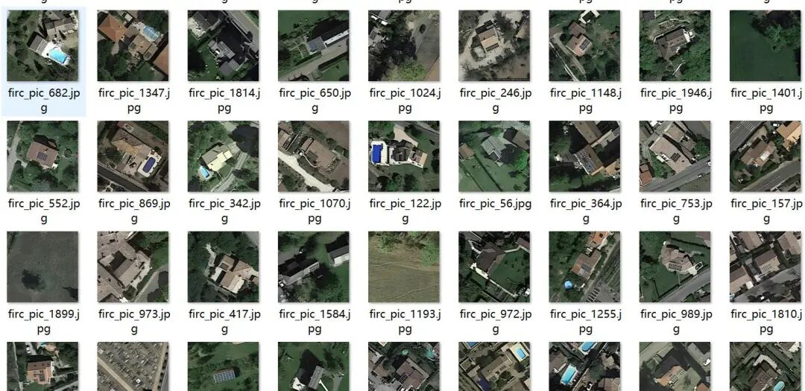
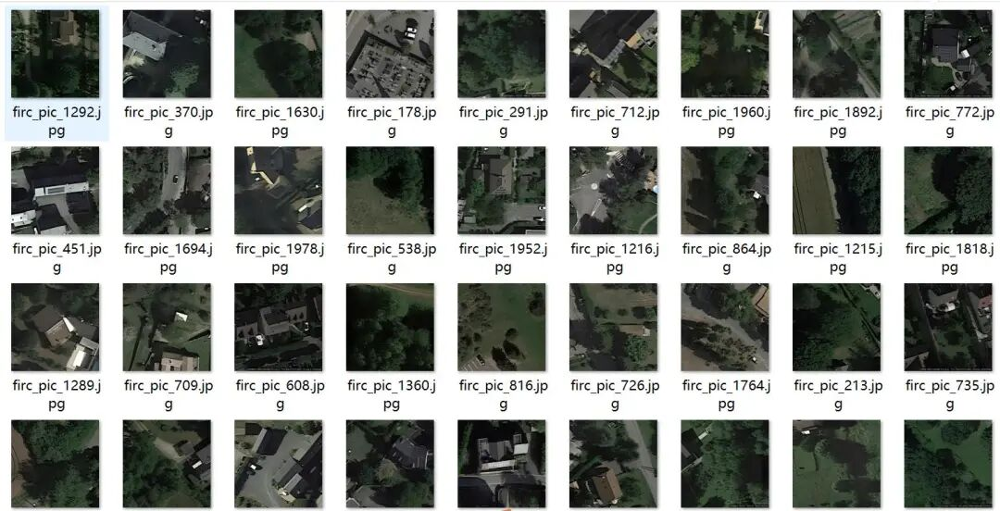
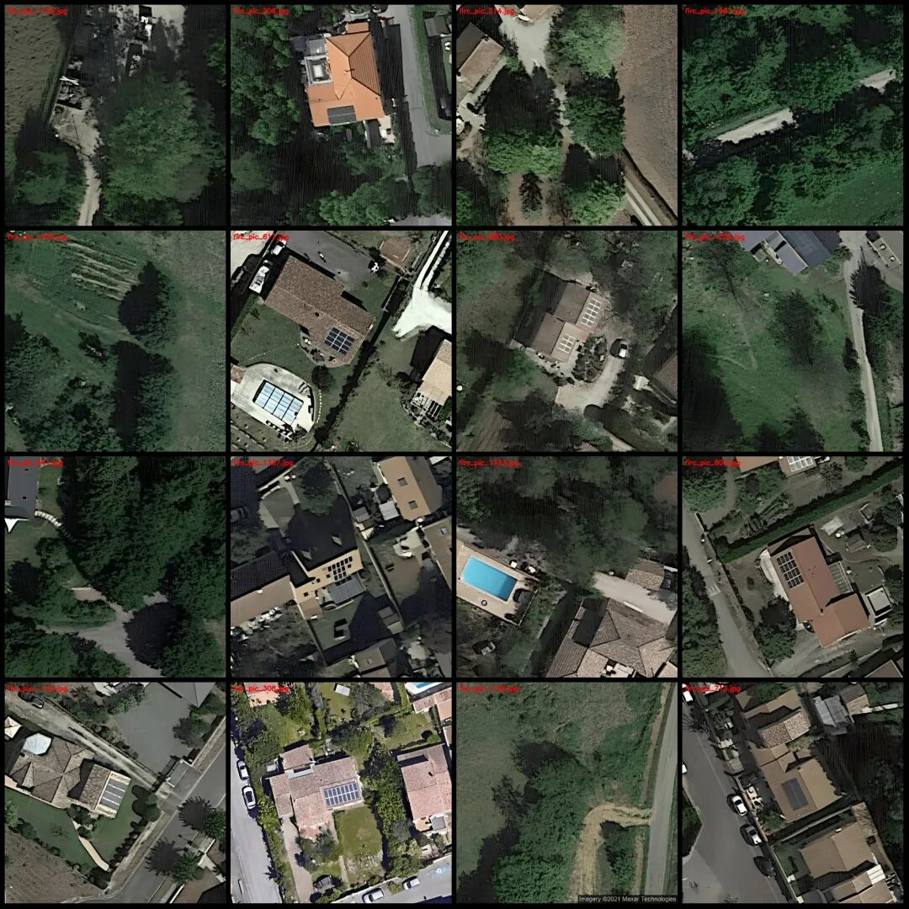
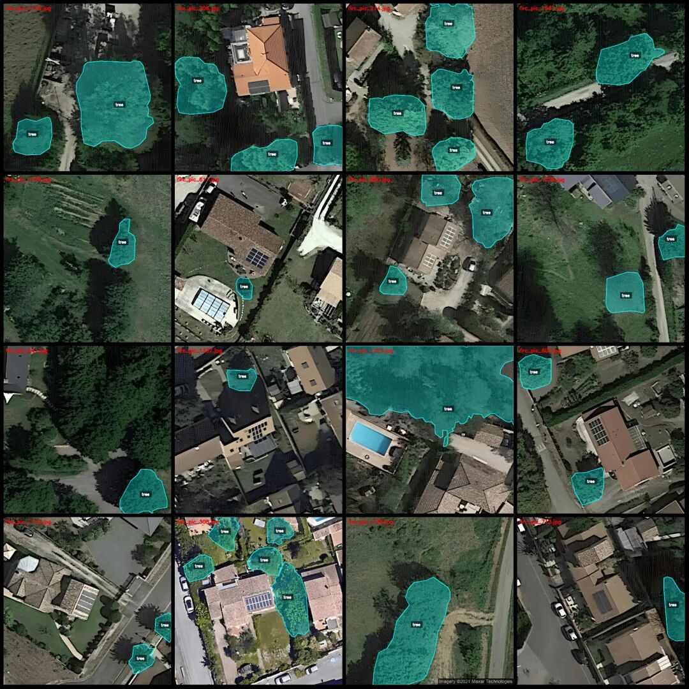
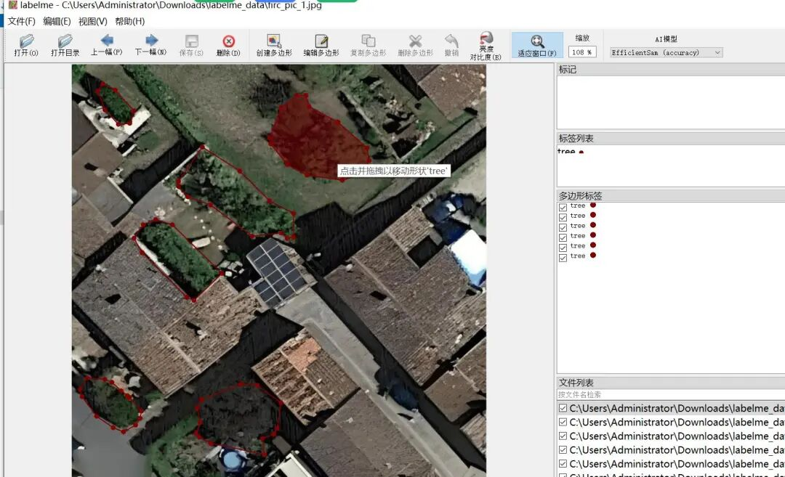

# UAV Aerial Photography Tree Segmentation and Identification Dataset in LabelMe Format - 2029 Images, 1 Category

Dataset format: labelme format (without mask files, only including jpg images and corresponding json files)

Number of images (number of jpg files): 2029

Number of annotations (json file count): 2029

Label category count: 1

Label category name: ["tree"]

Number of boxes labeled in each category:

tree count = 4945

Total frame count: 4945

Using labeling tool: labelme=5.5.0

Image resolution: 800x800

Annotation rules: Draw polygons around the categories.

Important Notice: The dataset can be opened and edited using LabelMe. For JSON datasets, one must convert them into mask or Yolo formats for semantic segmentation or instance segmentation.

Special : This dataset does not guarantee the accuracy of the trained models or weight files.

Image Preview:

Annotation example:

Original image (pick 16 randomly):

Annotation:

LabelMe editing example:

## Payment

Here is a pay link on Stripe ( https://buy.stripe.com/3cs8yP7sY87d0vu9AB ). Please contact me lonlonago@foxmail.com after funding $89, and I will send you a complete data files , thank you!

